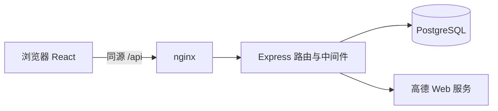

# 架构与学习路线

前端通过 Vite 构建为静态资源，由 nginx 提供。nginx 同源代理 API，避免在浏览器存储数据库信息、地图 Key 或登录令牌。Express 处理校验、权限和 HTTP 语义，数据访问使用 pg 参数化查询，推荐函数只处理普通对象。

## 为什么这样拆分

模块以明确职责拆分，不为每张表创建 controller/service/repository 三层模板。routes.js 展示完整请求流程，适合对照 Full Stack Open 的 Express 路由、中间件与错误处理学习。当某个业务明显变大时再提取对应模块。

React 使用函数组件、useState、useEffect 和少量自定义 hook。导航采用 URL hash，刷新详情可保留页面；搜索状态放在 App 内，返回发现页无需重新选择位置。没有引入状态管理库或复杂的通用表单框架。所有用户输入和第三方文本通过 React 文本节点呈现，不注入 HTML。

## 数据关系

- users → sessions：一人多会话，数据库仅保存会话令牌哈希。
- users ↔ restaurants：favorites 复合主键保证收藏唯一。
- users ↔ restaurants：reviews 唯一约束保证每个账号每店一条评价，保留 created_at 与 updated_at。
- restaurants：高德 source_id 唯一，固定坐标和基础信息持久化；距离在每次搜索中计算。
- 管理员覆盖字段独立保存，地图刷新不会覆盖人工修订；隐藏状态不会被刷新重置。
- schema_migrations：事务和 advisory lock 保证首次初始化可重复、安全串行。

## 可解释的工程点

外键和唯一约束兜住数据完整性；批量同步餐厅使用事务；SQL 参数与语句分离；密码使用随机 salt + scrypt；Cookie 使用 HttpOnly / SameSite；跨站写请求检查来源；用户身份、所有权和管理员角色由后端执行。限流采用单进程内存计数，适用于当前单实例，不声称是分布式防护。

测试分两层：纯函数单元测试验证排序、预算和坐标边界；真实数据库和真实 HTTP 集成测试验证多模块协作。地图只在测试环境中由 Postman 替身提供受控成功、空结果、错误、HTML 和超时响应。

## 后续迁移 TypeScript

先理解当前 JavaScript 数据流，再逐步给数据库结果、地图输入输出和 API 请求添加类型。不要在首次迁移时同时更换 ORM、后端框架和部署模型。可从 recommendation.js 的纯函数开始，之后覆盖 API 边界与 React props。

## 简历中可以写什么

可以按实际验证结果描述 React + Express + PostgreSQL 全栈实现、会话鉴权、数据库约束、可解释推荐和 Compose 部署。不要写不存在的用户量、推荐准确率、AI 情感分析或未经测量的吞吐量。真实地图接通与服务器上线后，再补充可核实的数据。
